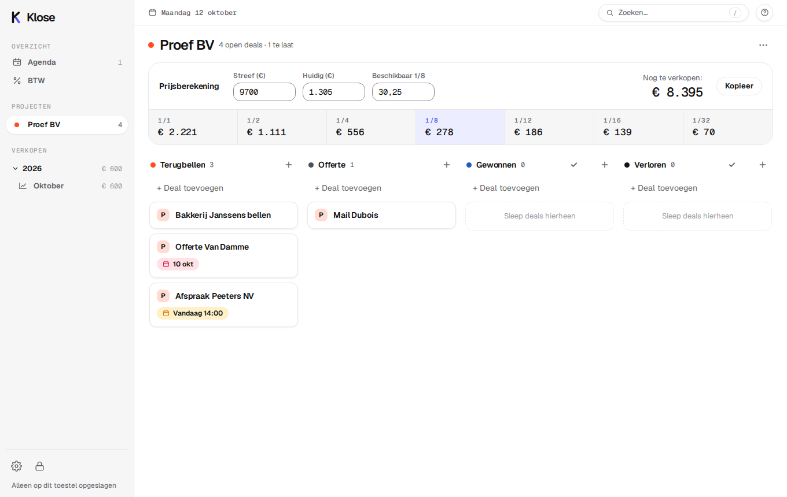
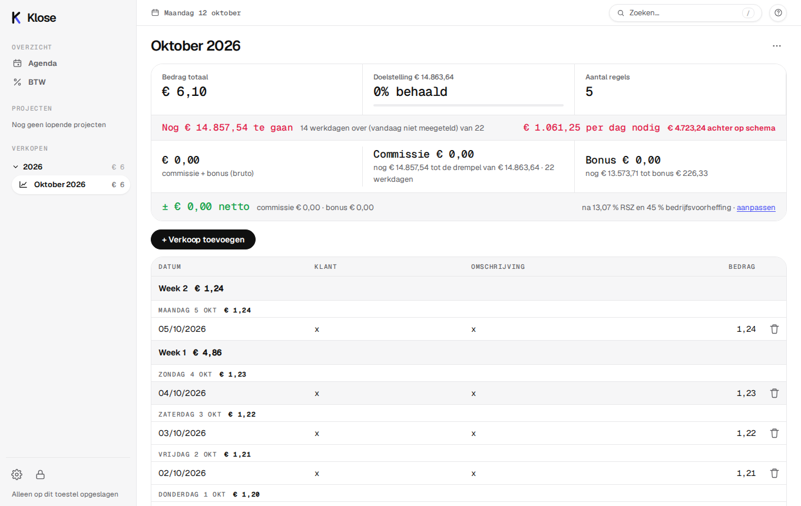
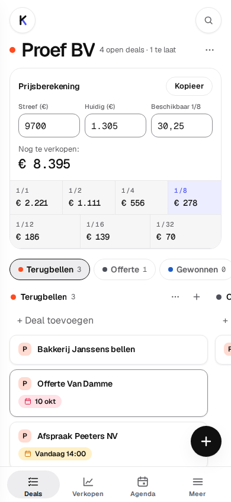

# Klose

**De CRM voor hardsales.** Deals, verkopen en agenda in één snelle app die volledig in je browser draait. Geen server nodig, geen abonnement: je gegevens blijven **versleuteld op je eigen toestel**, met optionele synchronisatie tussen al je toestellen.

Klose is gewone HTML, CSS en JavaScript, zonder framework en zonder build-stap. Hosten is niets meer dan de map uploaden.



<p>
  
  
</p>

## Wat kan het?

| Onderdeel | Wat je ermee doet |
|---|---|
| **Deals** | Projecten met een bord met vaste stappen (*Terugbellen, Offerte, Gewonnen, Verloren*, aanpasbaar). Sleep kaarten tussen kolommen. Per deal: deadline en uur, eigen velden, opmerkingen met afbeeldingen, archief. |
| **Prijsberekening** | Bovenaan elk project. Vul het streefbedrag, wat al verkocht is en de beschikbare 1/8-ruimtes in; Klose rekent de prijs per formaat uit (1/1 t/m 1/32) en wat er nog te verkopen is. |
| **Verkopen** | Een pagina per maand met een tabel (kolommen zelf in te stellen), doelstelling, bedrag per dag dat nog nodig is, tempo ten opzichte van het schema, en commissie en bonus. Importeren uit notities en export naar CSV. | Een deal die je op **Gewonnen** zet, komt automatisch als regel in de maand van die dag: titel → klant, veld *Prijs* → bedrag, veld *Formaat* → formaat. In *Instellingen → Deals → Stappen* kies je welke stap als verkoop telt.
| **Agenda** | Drukdata, deadlines en afspraken, met herhaling en Belgische feestdagen. |
| **BTW** | Reken een bedrag om van of naar inclusief btw (6, 9, 12 of 21 %). |

Ook handig:

- **Opmerkingen met afbeeldingen**: toevoegen met de knop, plakken of slepen; aanklikken om te vergroten. Afbeeldingen worden in de browser verkleind en zitten in de versleutelde kluis (metadata zoals locatie verdwijnt).
- **Licht en donker**, volgens je toestel of zelf gekozen.
- **Prijsberekening afdrukken**: klik bij een project op *Afdrukken* om de berekening in de stijl van Klose op papier te zetten of als PDF te bewaren, zonder je andere deals mee af te drukken.
- **Werkt offline** en is te installeren als app (PWA) op telefoon en computer, zonder app store.
- **Ontgrendelen met Face ID of Touch ID** op toestellen die dat ondersteunen.
- **Rondleiding** en hulp bij het eerste gebruik; functies die je niet nodig hebt (agenda, verkopen, btw) zet je uit in de instellingen.
- **Instellingen op één plek**: algemeen, account, deals, verkopen, beveiliging en gegevens (back-up, import).

### Sneltoetsen

| Toets | Actie |
|---|---|
| `N` of `Q`, `Ctrl/⌘ K` | Nieuwe deal |
| `/`, `Ctrl/⌘ F` | Zoeken |
| `Ctrl/⌘ 1` | Alle deals |
| `Ctrl/⌘ 5` | Verkopen (laatste maand) |
| `Ctrl/⌘ ,` | Instellingen |
| `Delete` | Open deal verwijderen |
| `Esc` | Sluiten |
| `?` | Alle sneltoetsen |

## Snel starten

Klose heeft geen installatie of build nodig. Serveer de map `taken/` met een willekeurige statische server:

```bash
git clone https://github.com/sbmusicbe/sbmusicbe.github.io.git
cd sbmusicbe.github.io/taken
python3 -m http.server 8000
```

Open daarna <http://localhost:8000>. Bij de eerste keer kies je een wachtwoord; daarmee wordt alles versleuteld.

> Open `index.html` niet rechtstreeks als bestand (`file://`): de versleuteling en de offline-modus hebben een webadres nodig (`http://localhost` volstaat).

## Zelf hosten

De app staat in de map `taken/` van deze repo en wordt met GitHub Pages gepubliceerd op `sbmusic.be/taken`. Elke statische hosting werkt: upload de map `taken/` ergens; alle paden zijn relatief.

## Je gegevens

- **Versleuteld in de browser.** Alles wordt met AES-GCM versleuteld; de sleutel wordt uit je wachtwoord afgeleid (PBKDF2, 310.000 rondes). Zonder wachtwoord kan niemand je gegevens lezen, ook de beheerder niet.
- **Vergrendelt zichzelf** na een tijd zonder activiteit.
- **Niet in zoekmachines**: de pagina vraagt Google en Bing met `noindex` om haar niet te tonen, niet te bewaren en niet te volgen. De map staat niet in de sitemap en er is geen link naar. Blokkeer de map niet in `robots.txt`: dan kan een zoekmachine de `noindex` niet lezen.
- **Geen derde partijen**: lettertypen staan in de map, geen tracking, geen externe scripts. Een strikte Content-Security-Policy staat in `index.html`.
- **Back-up** via *Instellingen → Gegevens*, versleuteld of leesbaar. Een verloren wachtwoord is onherstelbaar; bewaar daarom de **herstelsleutel** die Klose bij het aanmaken van een account toont.

Meer in [`SECURITY.md`](SECURITY.md): wat er beschermd is, wat niet, en wat je in Supabase zelf instelt.

## Synchroniseren tussen toestellen (optioneel)

Zonder account werkt Klose op één toestel. Met een account log je overal in en staan je gegevens overal: per account één **versleutelde** kluis in [Supabase](https://supabase.com) (gratis plan). De dienst kan de inhoud niet lezen.

1. Maak een Supabase-project en voer [`supabase.sql`](supabase.sql) uit in de SQL Editor (herhaalbaar).
2. Kopieer `cloud.example.json` naar `cloud.json` (in `taken/`) en vul je **Project URL** en **publishable key** in:
   ```json
   { "url": "https://JOUWPROJECT.supabase.co", "key": "sb_publishable_…" }
   ```
   Die sleutel is bedoeld om openbaar te zijn; de beveiliging zit in de regels uit het SQL-script. Gebruik **nooit** de *service role key* in de app of in deze repository.
3. Stel in Supabase de authenticatie in (e-mailbevestiging, redirect-URL, wachtwoordlengte). De stappen staan in [`MULTIUSER.md`](MULTIUSER.md) en [`SECURITY.md`](SECURITY.md).

Bestaat `cloud.json` niet, dan toont Klose gewoon een wachtwoordscherm en blijft alles lokaal. De workflow *Supabase wakker houden* (`.github/workflows/supabase-keepalive.yml` in de hoofdmap van de repo) roept je project elke week aan, zodat het gratis plan niet pauzeert; zonder `cloud.json` doet hij niets.

## Installeren als app (PWA)

Klose is een webapp die je kunt installeren, zonder app store en zonder extra programma:

- **Computer (Chrome, Edge):** klik rechts in de adresbalk op het installatiepictogram, of kies *Installeren*.
- **iPhone/iPad (Safari):** deelknop → *Zet op beginscherm*.
- **Android (Chrome):** menu → *App installeren*.

Daarna opent Klose in een eigen venster, werkt het offline en toont het rechtsonder een melding als er een nieuwe versie is.

## Projectstructuur

```
taken/
  index.html          pagina en beveiligingsregels (CSP)
  app.js              alle logica: gegevens, versleuteling, synchronisatie, schermen
  style.css             het hele ontwerp
  theme.js              thema vooraf instellen (geen flits) en anti-frame-beveiliging
  sw.js                 service worker voor offline gebruik en updatemelding
  manifest.webmanifest  installeerbare app (PWA)
  fonts/                Geist, Geist Mono en Shantell Sans (zelf gehost)
  supabase.sql          database voor de optionele synchronisatie
  cloud.example.json    voorbeeld voor de verbinding met Supabase
  SECURITY.md           veiligheid en privacy
  MULTIUSER.md          ontwerp en instellen van accounts
```

## Ontwerp

Klose heeft een eigen, rustige stijl: een wit vlak, zwarte capsule-knoppen, haarlijnen, pastelbadges met woord, één blauw accent en een handgeschreven krabbel. Alle kleuren, lettergroottes en afrondingen staan als variabelen bovenaan `style.css`; licht en donker delen dezelfde namen.

## Een nieuwe versie uitrollen

`sw.js` bewaart de app voor offline gebruik. Verhoog bij elke wijziging het cachenummer (`CACHE`) en voeg nieuwe bestanden toe aan `ASSETS`; gebruikers krijgen dan rechtsonder de melding om te verversen.

## Licentie

Nog niet gekozen. Zonder licentie blijft alle code van de eigenaar; voeg een `LICENSE` toe als anderen de code mogen gebruiken.

## Een probleem melden

Veiligheidsproblemen: zie [`SECURITY.md`](SECURITY.md). Stuur nooit wachtwoorden of herstelsleutels mee.
